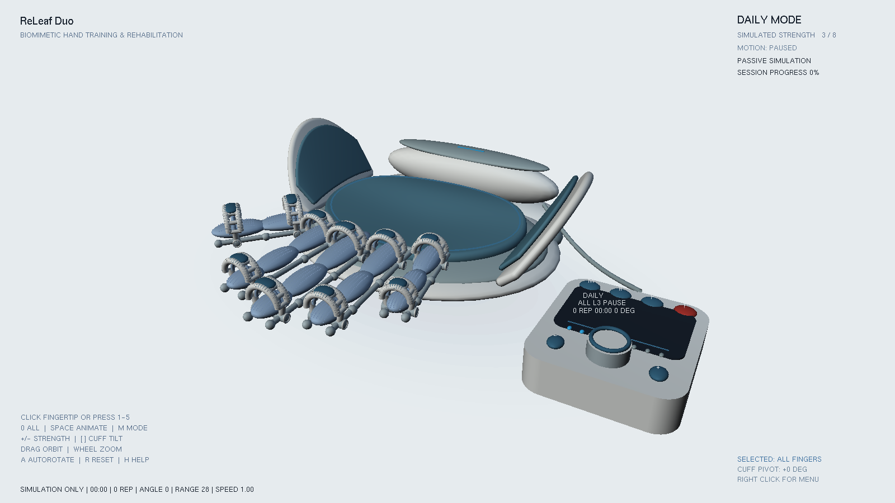

# ReLeaf Duo 2.0

基于 C++11 / OpenGL 固定管线 / FreeGLUT / GLU 的可交互手部训练产品概念。
所有阻力、辅助、训练进度及康复功能均为可视化模拟。
模型由程序生成，不依赖 Blender、贴图下载或其他建模软件。



## Windows：Code::Blocks + MinGW x64

1. 使用 **64 位 MinGW GCC**，在 Code::Blocks 的 GNU GCC 编译器设置中选择该工具链。
2. 打开 `ReLeaf_Duo.cbp`，选择 Debug 或 Release，执行 Build and Run。
3. 项目已包含 FreeGLUT 3.4.0 的头文件、x64 GNU 导入库和 DLL，无需另装 GLUT。
   构建后命令会将 `libfreeglut.dll` 复制到可执行文件目录；若 IDE 禁用了构建后命令，
   手动复制 `third_party/freeglut/bin/x64/libfreeglut.dll` 至 `bin/Debug` 或 `bin/Release`。
4. `opengl32` 和 `glu32` 由 Windows / MinGW 提供。项目使用 `-static` 嵌入 GCC C++
   运行库，并显式使用 `-l:libfreeglut.dll.a` 链接 FreeGLUT 的 DLL 导入库。
5. 不支持直接混用 32 位编译器、MSVC `.lib` 或其他架构的 GLUT DLL。

等价的 MinGW 命令（在项目根目录，先创建 `bin/Release`）：

```bat
g++ -std=c++11 -O2 -Wall -Wextra -Wpedantic -static -Ithird_party/freeglut/include main.cpp -Lthird_party/freeglut/lib/x64 -l:libfreeglut.dll.a -lopengl32 -lglu32 -o bin/Release/ReLeaf_Duo.exe
copy /Y third_party\freeglut\bin\x64\libfreeglut.dll bin\Release\libfreeglut.dll
```

可选 CMake 构建（MinGW 的终端，已配置 gcc/g++ 与 mingw32-make）：

```bat
cmake -S . -B build -G "MinGW Makefiles" -DCMAKE_BUILD_TYPE=Release
cmake --build build -j 4
build\ReLeaf_Duo.exe
```

本次已实际交叉编译 Windows x64 EXE 并检查导入 DLL；未在 Windows 或 Code::Blocks GUI 中
运行，尚需在目标电脑验证 Intel Arc 驱动、IDE 构建后命令和 DPI 表现。详见 [验证记录](docs/validation.md)。

## Linux 本地开发

需要 GCC、CMake、OpenGL/GLU 开发包和 FreeGLUT 开发包，例如 Debian 的
`libgl-dev libglu1-mesa-dev libglut-dev`。测试截图还需要 Xvfb 或真实 X11 显示服务。

```sh
cmake -S . -B build -DCMAKE_BUILD_TYPE=Release
cmake --build build -j 4
ctest --test-dir build --output-on-failure
./build/ReLeaf_Duo
```

无 OpenGL 开发库时，仍可运行独立几何测试：

```sh
g++ -std=c++11 -O2 -Wall -Wextra -Wpedantic tests/geometry_test.cpp -o geometry_test
./geometry_test
```

## 操作

| 操作 | 功能 |
|---|---|
| 左键拖动 / 滚轮 | 轨道旋转 / 缩放 |
| 点击指尖指环 / `1`–`5` | 选择拇指、食指、中指、无名指、小指 |
| `0` | 选择全部手指 |
| `Space` | 开始 / 暂停，暂停保持当前姿态 |
| `M` | 日常 / 康复模式 |
| `+` / `-` | 调节模拟阻力或辅助强度，不收紧指环 |
| `[` / `]` | 调节选中指环 ±5°，限制在 ±20°；选中全部时同时调节 |
| `J` / `K` | 调节运动范围，8°–32° |
| `,` / `.` | 调节速度，0.25×–2× |
| `T` | 日常模式下切换同步 / 顺序屈曲 |
| `B` | 切换被动 / 主动辅助模拟 |
| `E` | 模拟急停，停止动画并保持姿态；Space 恢复 |
| `A` | 自动旋转开关 |
| `R` | 重置视角与选择，保留指环配合与训练参数 |
| `V` / `F` / `S` | 俯视 / 正视 / 侧视 |
| `H` | 显示 / 隐藏操作帮助 |
| `W`、`Q`、`D` / 方向键 | 辅助调节视角 |
| 右键 | 训练、模式、强度和视角菜单 |
| `Esc` | 退出 |

外置控制器可直接点击：`M` 切模式，`II` 开始/暂停，`F` 循环选择手指，红色 `!` 急停；
`+`/`-` 调强度，旋钮点击循环 1–8 级。拾取基于实际模型投影，选择最近的可见屏幕目标；
它不是基于射线与三角网格的精确遮挡拾取。

控制器和 HUD 显示状态、强度、所选手指、角度、时间、次数与模拟进度。
每完成 20 次屈曲自动暂停，再次启动开始新一轮。康复模式具有更慢的速度和更小的运动幅度。

## 几何与材料

- `geometry.h`：三次 Bézier 曲面、解析控制点裁剪、数值法线、封闭厚壳与圆角边缘、
  独立柔软内衬、成人五指参数和掌托高度场。模型单位约为 30 mm。
- 双翼壳厚约 5.1 mm，内衬厚约 2.7 mm；内衬与壳体分开，圆边共享边界索引。
- 五指长度约 55 / 75 / 84 / 78 / 60 mm；四指为三段层级，拇指两段并向外斜置。
  左翼前端退至拇指根后方；其余手指用横向安全间距避开翼面。
- 指环位于支撑上方，短横向轴、支架与骨架在下方连接；配合角绕下方固定轴调整。
- 掌托为凹形软垫，带圆滑裙边和接缝；底座降低，后部电机壳后移以留出放掌区域。
- 中性主方向光、较弱补光和受控环境光；塑料、泡棉、硅胶与金属区分高光和颜色。
  绘制的接触阴影是视觉近似。

## 截图与自动验证

`screenshots/` 中的图片均由实际 OpenGL 程序读取帧缓冲生成；`preview_3D.png` 保留为原有参考。

```sh
./build/ReLeaf_Duo --self-test --capture check.ppm
./build/ReLeaf_Duo --view top --capture top.ppm
./build/ReLeaf_Duo --view side --capture side.ppm
./build/ReLeaf_Duo --view front --capture front.ppm
./build/ReLeaf_Duo --flex --capture flexion.ppm
./build/ReLeaf_Duo --play --frames 120 --capture animation.ppm
./build/ReLeaf_Duo --size 2880 1800 --capture highdpi.ppm
```

Linux 无显示器时可用 `xvfb-run -a` 执行上述命令。PPM 可用任意支持它的图像工具转换成 PNG。
`--self-test` 验证实际回调与状态，包括指环独立调整、选择、控制器点击、模式、强度、
摄像机、缩放、暂停、急停、计次、20 次自动完成和 OpenGL 错误状态。

默认窗口为 1600×900；Windows 请求 DPI 感知，HUD 在高分辨率使用可缩放文字。
可调整窗口，未假定进程或本地路径可以跨机器继续使用。
